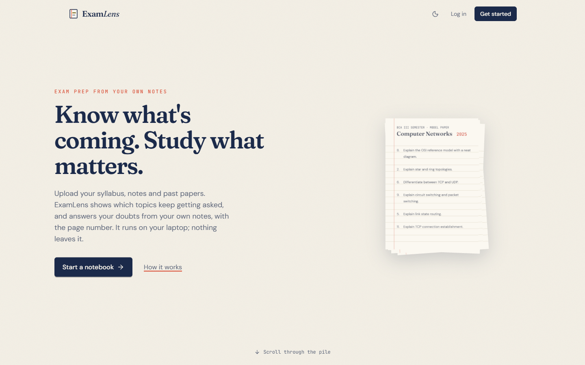
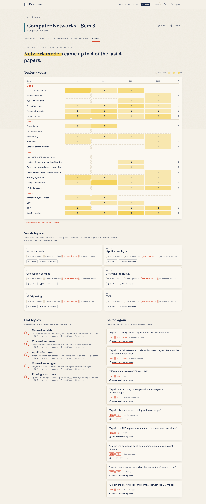
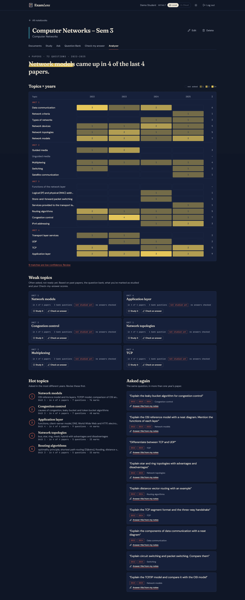
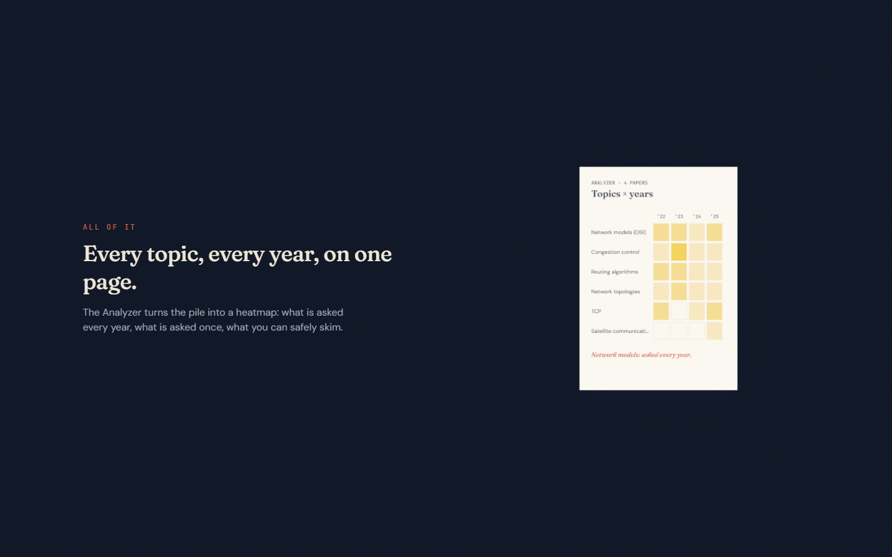
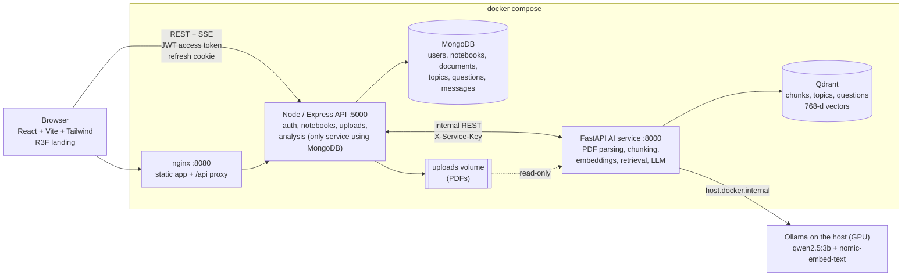

# ExamLens

> **Know what's coming. Study what matters.**

ExamLens is a private, offline exam-prep app for university students. Upload your **syllabus**, your **notes** and as
many **past papers** as you can find. ExamLens reads every question, ties it to a syllabus topic and shows you which
topics come up year after year. Ask it a doubt and it answers **only from your own notes**, with the page number
next to every point. Everything runs on your laptop with local models through [Ollama](https://ollama.com): free,
and no notes ever leave the machine.



## What it does

- **Analyzer:** a topics × years heatmap of your past papers. Hot topics are ranked by how many different years
  they were asked in, then by marks. "Asked again" lists questions that appear in more than one year's paper. Click
  any cell to see the actual questions, and move a question to another topic if the match is wrong (low-confidence
  matches are flagged for review).
- **Ask your notes:** retrieval-augmented answers that stream in as short exam-style bullet points. Every fact
  carries a `p. 14` sticker; hover it to see the passage it came from. If your notes don't cover the question,
  ExamLens says so instead of guessing.
- **Documents:** drag-and-drop upload, live processing status, retry for failed files.
- **Private by design:** local LLM and embeddings, local vector database, accounts with JWT + rotating refresh
  tokens, and every search is scoped to the notebook it belongs to.

| | |
|---|---|
|  |  |
| **Analyzer:** heatmap, hot topics, repeated questions | **Ask:** streamed answers with page stickers |
|  |  |
| **Documents:** upload tray and status chips | **Dashboard:** one notebook per subject |
|  |  |
| **Night study mode** (dark theme) | **Landing:** the 3D pile of papers becomes a heatmap |

The screenshots use the demo notebook: a Computer Networks syllabus, four sets of class notes and four
**sample papers generated for testing** (2022–2025). They are not official university papers.

## Architecture



**Design decisions**

- **Node owns the data, Python owns the AI.** The Express API is the only service that touches MongoDB; the
  FastAPI service never writes to it. When it finishes processing a PDF it calls back
  `PATCH /api/v1/internal/documents/:id` with the results (protected by a shared `X-Service-Key`).
- **Multi-tenant isolation.** Node checks that the user owns the notebook before calling the AI service, and every
  Qdrant search is filtered by `space_id`, so one student's question can never retrieve another student's notes.
- **Ollama stays on the host** so it can use the GPU (built on an RTX 3050 laptop); containers reach it through
  `host.docker.internal`.
- **Same origin in production.** nginx serves the React build and proxies `/api` to Node, so there's no CORS and the
  httpOnly refresh cookie just works. SSE answers pass through with `proxy_buffering off`.
- **One id everywhere.** The AI service creates topic and question ids in MongoDB ObjectId format, so the same id is
  used in Qdrant and MongoDB.

## How the AI part works

| Step | What happens |
|---|---|
| **Upload** | Node saves the PDF (magic-byte checked, ≤ 20 MB), returns `202`, and asks the AI service to ingest it. One document is processed at a time. |
| **Text** | PyMuPDF extracts text per page. Lines repeated on most pages (headers, footers, "Page 3 of 9") are removed, and glued CamelCase words are split. Scanned PDFs are rejected with a friendly message (OCR is on the v2 list). |
| **Notes** | Page-aware chunks (~800 chars, 150 overlap) → `nomic-embed-text` (with `search_document:` / `search_query:` prefixes) → Qdrant. |
| **Syllabus** | Units are found by their "Unit 3 / UNIT-III / Module 3" headings. Units written as "Label: item, item." are parsed directly (exact and repeatable); other formats go to `qwen2.5:3b` with a JSON schema at temperature 0. |
| **Past papers** | Regex extraction of numbers, sub-parts and marks (section headers like `(6 x 2 = 12)` fill in missing marks); falls back to the LLM if fewer than 5 questions are found. Each question is matched to its nearest topic. |
| **Repeats** | Two questions are the same if they are semantically close (cosine ≥ 0.85) **and** share ≥ 60% of their content words. Embeddings alone call "half duplex" vs "full duplex" a repeat. |
| **Ask** | Top-5 chunks from this notebook → if even the best one is weakly related, "I couldn't find this in your notes" → otherwise a grounded prompt streams the answer over SSE, with `[p. N]` citations turned into stickers. |

All thresholds were measured on real test data, not guessed. The numbers are in [docs/BUILD_NOTES.md](docs/BUILD_NOTES.md).

## Tech stack

| Layer | Tools |
|---|---|
| Frontend | React 18, Vite, Tailwind CSS v4, React Router, Axios, Framer Motion, React Three Fiber (landing only), lucide-react, self-hosted Fraunces / DM Sans / JetBrains Mono |
| API | Node 24, Express 5, Mongoose, bcrypt, jsonwebtoken, cookie-parser, multer, zod, helmet, cors, express-rate-limit, morgan |
| AI service | Python 3.12, FastAPI, Uvicorn, Pydantic, PyMuPDF, httpx, qdrant-client |
| Models | `qwen2.5:3b` (chat), `nomic-embed-text` (768-d embeddings) via Ollama |
| Data | MongoDB 7, Qdrant |
| Tooling | Docker Compose, nginx, Postman / newman, Git |

## Run it

### Requirements

- [Docker Desktop](https://www.docker.com/products/docker-desktop/)
- [Ollama](https://ollama.com) running on the host, with both models:
  ```bash
  ollama pull qwen2.5:3b
  ollama pull nomic-embed-text
  ```

### With Docker (recommended)

```bash
git clone <this repo> && cd examlens
cp .env.example .env        # then replace the three secrets, e.g. with:
                            # node -e "console.log(require('crypto').randomBytes(48).toString('hex'))"
docker compose up -d --build
```

Open **http://localhost:8080**. The first build takes a few minutes; later starts take about 20 seconds.

**Demo data (optional).** Put PDFs in `samples/` (the folder is gitignored). File names decide what they are:
`syllabus` in the name → syllabus, a year like `2023` → past paper of that year, anything else → notes. Then:

```bash
docker compose --profile demo run --rm seed
```

This creates **demo@examlens.local / examlens-demo**, uploads everything, waits until it's processed and asks one
example question. Running it again skips files that are already uploaded (`--reset` starts the notebook over).

Only port 8080 (plus MongoDB and Qdrant for dev mode) is published. The API and the AI service are reachable only
inside the Docker network.

### For development (hot reload)

```bash
docker compose up -d mongo qdrant                       # databases only

cd server && cp .env.example .env && npm install && npm run dev       # API → http://localhost:5000/api/v1
cd ai-service && cp .env.example .env                                  # SERVICE_KEY must match server/.env
python -m venv .venv && .venv/Scripts/pip install -r requirements.txt  # macOS/Linux: .venv/bin/pip
.venv/Scripts/python -m uvicorn app.main:app --port 8000               # AI service → http://localhost:8000
cd client && cp .env.example .env && npm install && npm run dev        # app → http://localhost:5173

node scripts/seed-demo.mjs                                             # optional demo data (dev API)
```

Use either the full Docker stack or the dev servers at one time: both use the same MongoDB and Qdrant.

### Tests

The Postman collection in [postman/](postman/) covers every route, with assertions (auth, validation errors,
uploads, ownership, SSE, analysis):

```bash
npx newman run postman/ExamLens.postman_collection.json                                  # dev API
npx newman run postman/ExamLens.postman_collection.json --env-var baseUrl=http://localhost:8080/api/v1   # Docker
```

## API at a glance

Base `/api/v1`, JSON, errors as `{ "error": { "code", "message" } }`.

| | |
|---|---|
| `POST /auth/register`, `/auth/login`, `/auth/refresh`, `/auth/logout`, `GET /auth/me` | JWT access token + httpOnly refresh cookie, rotated on every refresh, reuse detected |
| `GET/POST /spaces`, `GET/PATCH/DELETE /spaces/:id` | Notebooks |
| `POST/GET /spaces/:id/documents`, `POST …/:docId/retry`, `DELETE …/:docId` | PDF upload (202), list, retry, delete (also removes vectors) |
| `POST /spaces/:id/ask` | Server-Sent Events: `token` … `done {citations}` |
| `GET/DELETE /spaces/:id/messages` | Ask history |
| `GET /spaces/:id/analysis` | Heatmap, hot topics, repeats (MongoDB aggregations) |
| `GET /spaces/:id/questions?topic=&year=&confidence=low`, `PATCH …/questions/:qid` | Questions behind a cell; move a question to another topic |
| `GET /health` | API, MongoDB and AI service status |

## Project structure

```
examlens/
├── client/        React app (pages, components, hooks, api, three/ for the 3D landing), Dockerfile + nginx.conf
├── server/        Express API: config, models, controllers, routes, middleware, services, validators
├── ai-service/    FastAPI: routers (ingest, ask, rematch, documents, health) and services (pdf, chunking,
│                  embeddings, qdrant, llm, syllabus, questions, matching, answer, ingest)
├── scripts/       seed-demo.mjs
├── postman/       API collection + fixtures
├── docs/          BUILD_NOTES.md (decisions and measurements), screenshots/
└── docker-compose.yml
```

## Roadmap (v2)

- Quiz generator from your notes
- Weak-topic dashboard (what you've asked about vs what the papers ask)
- Share notebooks with classmates (viewer / editor roles)
- OCR for scanned papers
- Kannada and Hindi question papers
- GitHub Actions CI (lint, Postman run against the Docker stack)

## Credits

- `BlurText`, `CountUp` and `SpotlightCard` are adapted from [React Bits](https://reactbits.dev) by David Haz
  (MIT + Commons Clause, see [client/src/components/reactbits/LICENSE.md](client/src/components/reactbits/LICENSE.md)).
- Fonts: Fraunces, DM Sans and JetBrains Mono (SIL Open Font License), self-hosted via Fontsource.

Built by Sachin Katigar (BCA) as a portfolio project.
