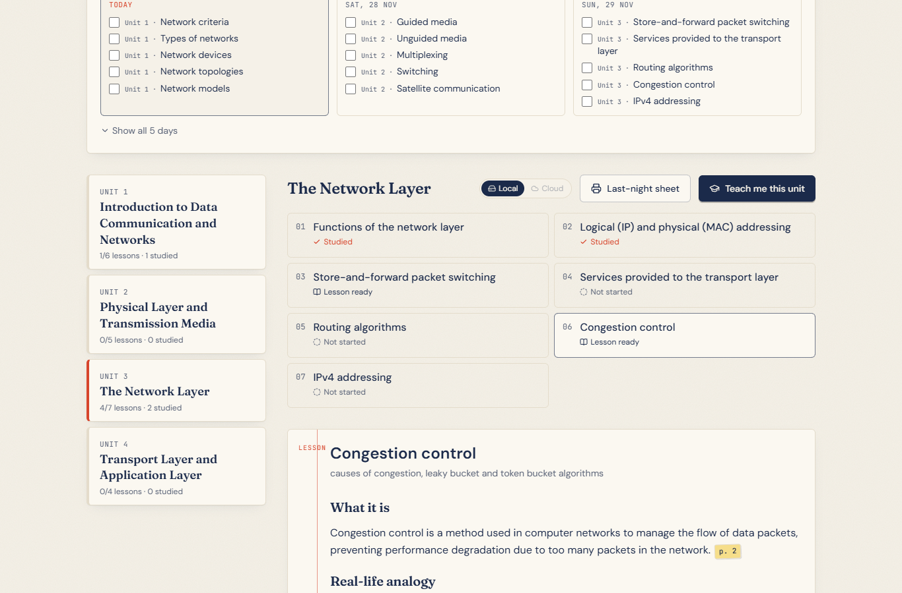
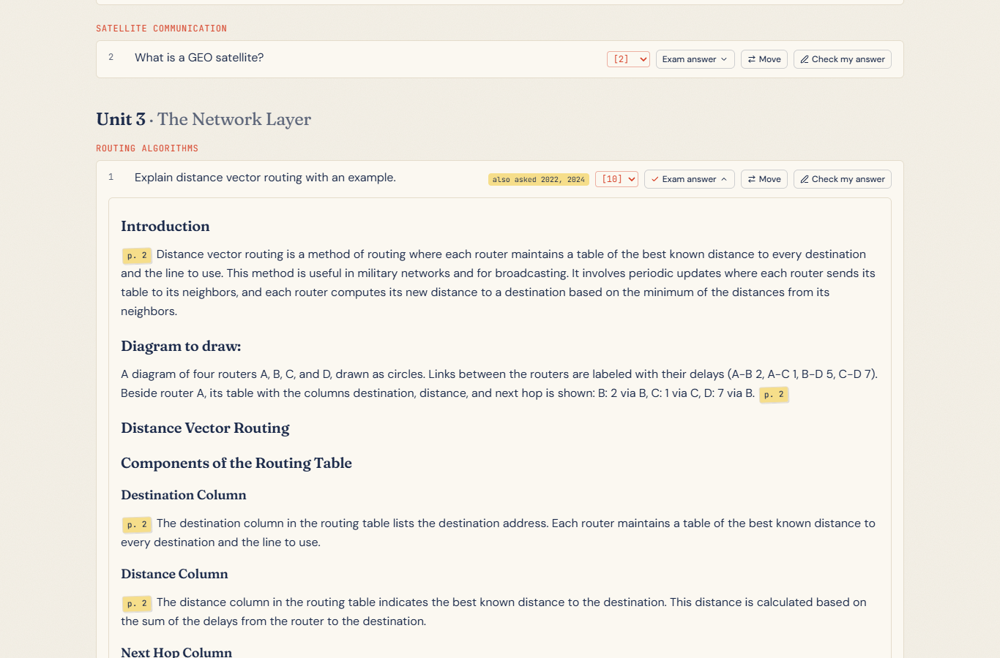
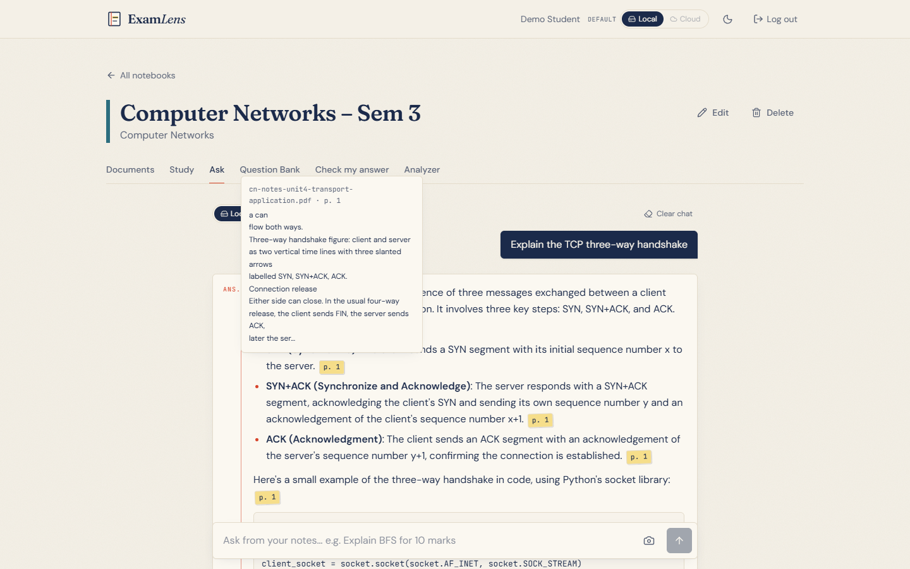
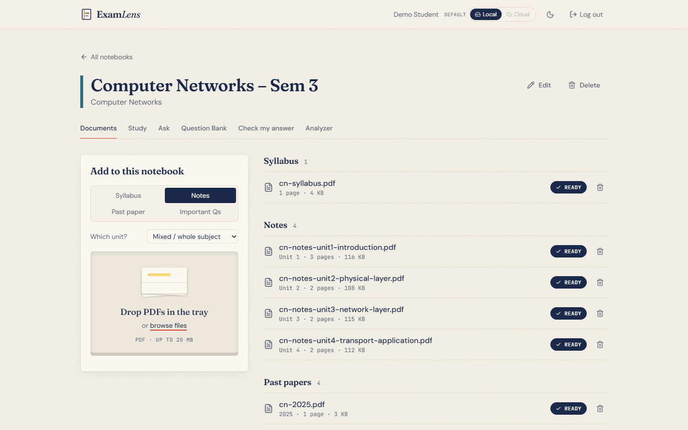
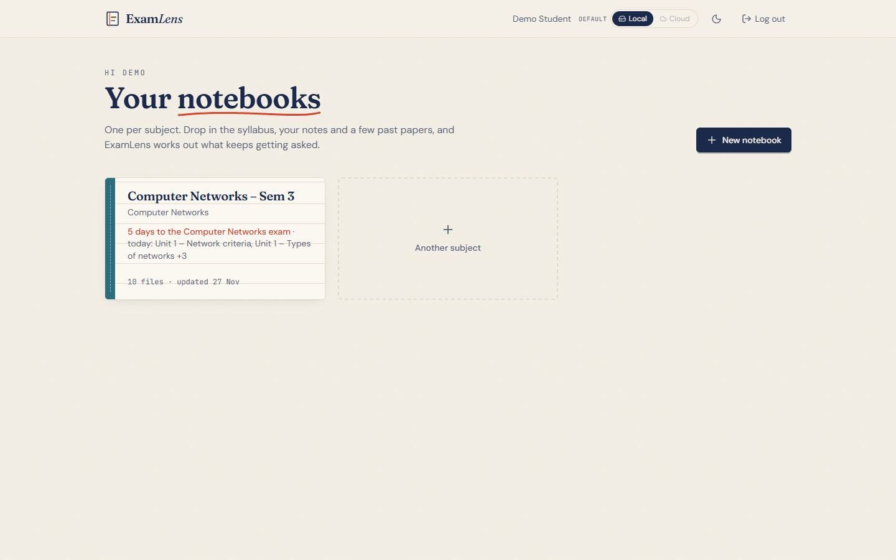
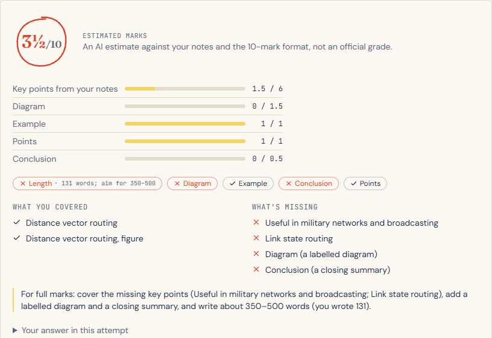
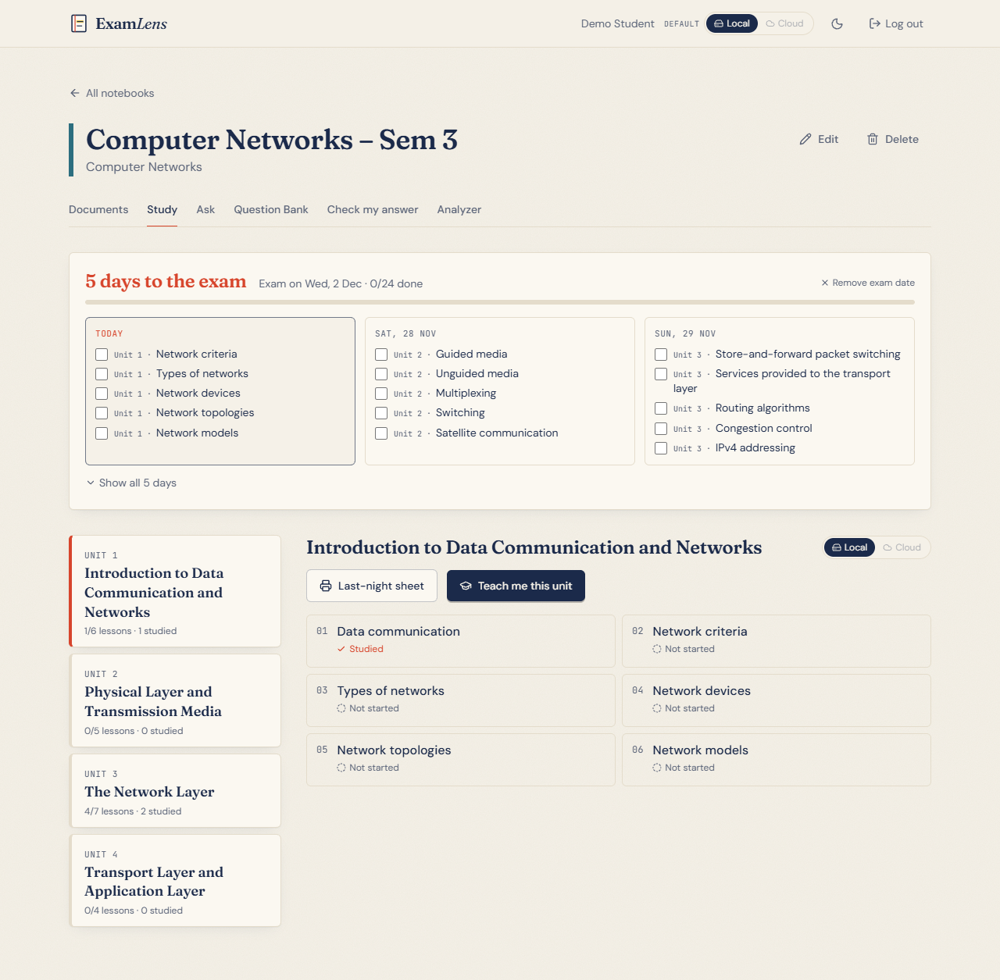
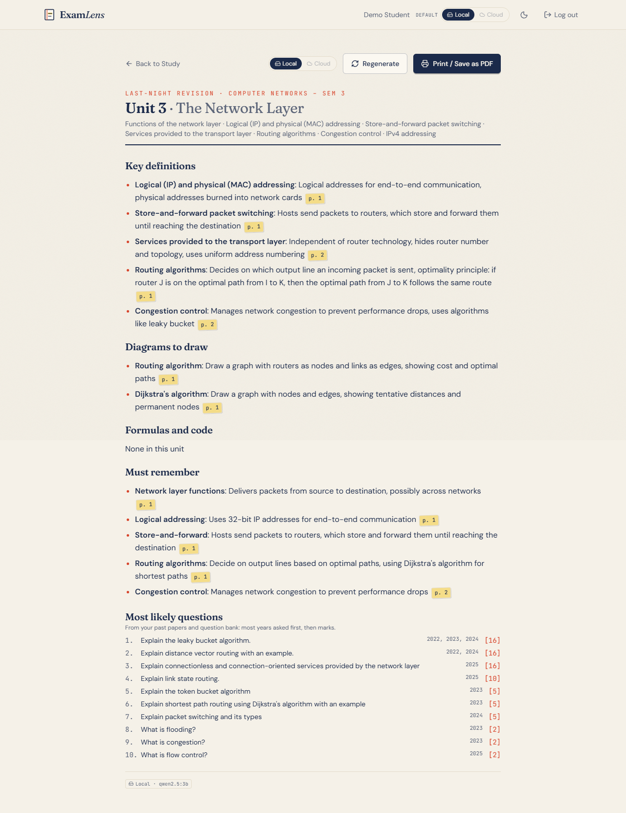
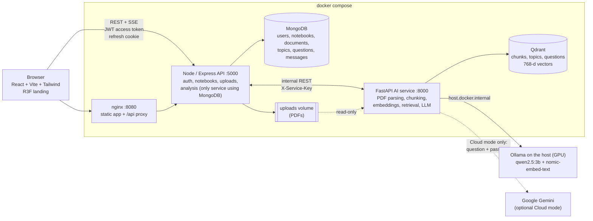

# ExamLens

[](https://github.com/sachinkatigar23/examlens/actions/workflows/ci.yml)

> **Know what's coming. Study what matters.**

**[▶ Live demo](https://sachinkatigar23.github.io/examlens/)**: a read-only copy of the demo notebook (recorded
answers, no live AI), straight in without an account.

ExamLens is a private exam tutor for university students. Upload one subject's **syllabus**, **unit notes**, **past
papers** and the college's **"important questions"** PDF. ExamLens shows which topics come up year after year,
**teaches each unit from scratch**, writes an **exam answer for every important question, sized to its marks**, and
solves a **photographed doubt** step by step. Every answer comes **only from your own notes**, with the page number
next to every point. By default everything runs on your laptop with local models through [Ollama](https://ollama.com):
free, and no notes ever leave the machine. An optional **Cloud** mode (Google Gemini) gives stronger answers when you
choose it.


## What it does

- **Study mode:** pick a unit, see its topics (not started / lesson ready / studied ✓) and press **Teach me this
  unit**. Each topic is taught from scratch in simple English: what it is, a real-life analogy, how it works step by
  step, key terms, an example or code, what to draw in the exam and an exam tip, all cited to your notes. Lessons are
  saved; a follow-up chat under each lesson is scoped to that unit.
- **Question Bank:** upload the college's important-questions PDF and every question is sorted into its unit and
  topic with its marks (taken from headings like "5-Marks Questions"; editable). **Exam answer** writes a
  marks-aware answer: 2 marks = definition + example, 5 = intro + key points, 10/16 = introduction, sub-headings,
  *diagram to draw*, example/code/table, advantages, conclusion. **Answer all** works through the bank in the
  background (resumable), and the **answer booklet** prints to PDF. A badge shows "also asked in 2023, 2025" when a
  past paper had the same question.
- **Check my answer:** pick a question (or type one), then type your own answer or photograph your handwritten
  sheet. You get an **estimated mark** with the breakdown behind it (key points from your notes, diagram, example,
  points, conclusion), what you covered, what's missing, and a **full-marks version** of your own answer, cited to
  your notes. Every attempt is saved, so you can watch a question go from 3/10 to 8/10.
- **Exam countdown:** set the exam date and get a day-by-day plan: the most-asked topics (past-paper years, marks,
  question bank) make the cut, studied ones drop out, and the day before the exam is revision day. Tick topics off;
  miss a day and the plan is redone from today. The dashboard says "4 days to the AI exam · today: Unit 2 – …".
- **Last-night revision sheet:** one printable page per unit with key definitions, diagrams to draw, formulas/code
  and must-remember facts from your notes, plus the unit's most likely questions with their marks.
- **Snap a doubt:** photograph a printed problem or a piece of code, check the transcription, and get a step-by-step
  solution that follows the method in your notes (for code: the bug and the fixed code).
- **Local or Cloud, your choice:** every answer shows which model wrote it (`Local · qwen2.5:3b` /
  `Cloud · gemini-3.5-flash-lite`). Local is the default. Next to the toggle, ExamLens shows how much of today's
  free Cloud quota is left ("≈14 of 20 left today", or "limit reached · resets 1:30 PM").
- **Analyzer:** a topics × years heatmap of your past papers. Hot topics are ranked by how many different years
  they were asked in, then by marks. "Asked again" lists questions that appear in more than one year's paper. Click
  any cell to see the actual questions, and move a question to another topic if the match is wrong (low-confidence
  matches are flagged for review). **Weak topics** lists what is asked often but isn't ready yet: past-paper years
  and question-bank count against whether you've studied it and your Check-my-answer scores for that topic, with
  one click to study it.
- **Ask your notes:** retrieval-augmented answers from your **notes only**, rendered as Markdown (headings, tables,
  highlighted code). Say "for 10 marks" and the answer takes that shape. Every fact carries a `p. 14` sticker;
  hover it to see the passage it came from. If your notes don't cover the question, ExamLens says so instead of
  guessing; "hi" gets a one-line hello, not a search.
- **Documents:** drag-and-drop upload, live processing status, retry for failed files.
- **Private by design:** local LLM and embeddings, local vector database, accounts with JWT + rotating refresh
  tokens, and every search is scoped to the notebook it belongs to.

| | |
|---|---|
|  |  |
| **Study:** a unit taught topic by topic | **Question Bank:** marks-aware exam answers |
|  |  |
| **Analyzer:** heatmap, hot topics, repeated questions | **Ask:** streamed answers with page stickers |
|  |  |
| **Documents:** upload tray and status chips | **Dashboard:** one notebook per subject |
|  |  |
| **Check my answer:** an estimated mark you can trace | **Exam countdown:** a day-by-day plan in Study |
|  | |
| **Last-night sheet:** one printable page per unit | |
|  |  |
| **Night study mode** (dark theme) | **Landing:** the 3D pile of papers becomes a heatmap |

All screenshots use the demo account and the Computer Networks set in [demo-data/](demo-data/): a sample syllabus,
four **model papers generated for testing** (2022–2025, not official university papers), short notes per unit and an
important-questions list. Every answer in them was written by the Local model (`qwen2.5:3b`).

### Local vs Cloud: what leaves your machine

| | Local (default) | Cloud (optional) |
|---|---|---|
| Chat model | `qwen2.5:3b` in Ollama on your GPU | Google Gemini (`GEMINI_MODEL`) |
| Sent over the internet | nothing | the question, the few note passages retrieved for it, your typed answer (Check my answer), and for photos the image |
| PDFs, indexing, search | on your machine | **still on your machine**: embeddings are always local, so switching never needs re-indexing |

Cloud needs `GEMINI_API_KEY` in `ai-service/.env`; without it the toggle shows Cloud as "not set up". The
first time you switch to Cloud, ExamLens shows this privacy note. If the local model is offline, an answer
offers "Use Cloud for this answer?" instead of switching silently. "Check my answer" uses Local for typed answers
and Cloud for photos (reading handwriting), unless you change the toggle.

## Architecture



**Design decisions**

- **Node owns the data, Python owns the AI.** The Express API is the only service that touches MongoDB; the
  FastAPI service never writes to it. When it finishes processing a PDF it calls back
  `PATCH /api/v1/internal/documents/:id` with the results (protected by a shared `X-Service-Key`).
- **Multi-tenant isolation.** Node checks that the user owns the notebook before calling the AI service, and every
  Qdrant search is filtered by `space_id`, so one student's question can never retrieve another student's notes.
- **Ollama stays on the host** so it can use the GPU (built on an RTX 3050 laptop); containers reach it through
  `host.docker.internal`.
- **Same origin in production.** nginx serves the React build and proxies `/api` to Node, so there's no CORS and the
  httpOnly refresh cookie just works. SSE answers pass through with `proxy_buffering off`.
- **One id everywhere.** The AI service creates topic and question ids in MongoDB ObjectId format, so the same id is
  used in Qdrant and MongoDB.

## How the AI part works

| Step | What happens |
|---|---|
| **Upload** | Node saves the PDF (magic-byte checked, ≤ 20 MB), returns `202`, and asks the AI service to ingest it. One document is processed at a time. |
| **Text** | PyMuPDF extracts text per page. Lines repeated on most pages (headers, footers, "Page 3 of 9") are removed, and glued CamelCase words are split. Scanned PDFs are rejected with a friendly message (OCR is on the v2 list). |
| **Notes** | Page-aware chunks (~800 chars, 150 overlap) → `nomic-embed-text` (with `search_document:` / `search_query:` prefixes) → Qdrant. |
| **Syllabus** | Units are found by their "Unit 3 / UNIT-III / Module 3" headings. Units written as "Label: item, item." are parsed directly (exact and repeatable); other formats go to `qwen2.5:3b` with a JSON schema at temperature 0. |
| **Past papers** | Regex extraction of numbers, sub-parts and marks (section headers like `(6 x 2 = 12)` fill in missing marks); falls back to the LLM if fewer than 5 questions are found. Each question is matched to its nearest topic. |
| **Repeats** | Two questions are the same if they are semantically close (cosine ≥ 0.85) **and** share ≥ 60% of their content words. Embeddings alone call "half duplex" vs "full duplex" a repeat. |
| **Question bank** | "UNIT – II" and "5-Marks Questions" headings give each question its unit and marks (97/97 on the real AI bank). With no syllabus in the notebook, topics are derived from the bank: each long question names its topic (temperature 0; a name must share a word with its question), names are merged by their distinctive words, short questions follow by keyword → most similar long question → a constrained LLM choice, then a similarity check moves strays and an over-full topic is split. |
| **Units** | Notes are uploaded for a unit (or "Mixed"); every chunk is tagged with its unit and nearest topic, and re-tagged when the syllabus changes. Study lessons retrieve by unit/topic. |
| **Answers** | Notes-only retrieval (more passages for more marks: 2→4, 5→6, 10→10, 16→12) → if even the best one is weakly related, "I couldn't find this in your notes" → otherwise a marks-shaped prompt streams the answer over SSE, with `[p. N]` citations turned into stickers. |
| **Citations** | After every answer: citations of pages that weren't retrieved are removed, uncited lines get the page of the passage they match, and an answer that matches no passage says so instead of showing unrelated pages. |
| **Check my answer** | The model lists the key points a full-marks answer needs (from the notes) and whether your answer has each, double-checked by word overlap. Code checks the format (length, diagram, example, points, conclusion) and adds up a fixed marking scheme, e.g. 10 marks = key points 6 + diagram 1.5 + example 1 + points 1 + conclusion 0.5. |
| **Planner** | No LLM: priority = 2 × past-paper years + highest marks / 5 + 1 if in the bank + 0.25 per bank question. At most 5 topics a day, learnt in syllabus order. |
| **Providers** | `llm/base.py` interface (`stream_chat`, `chat_json`, `vision`) with an Ollama and a Gemini implementation, picked per request. |

All thresholds were measured on real test data, not guessed. The numbers are in [docs/BUILD_NOTES.md](docs/BUILD_NOTES.md).

## Tech stack

| Layer | Tools |
|---|---|
| Frontend | React 18, Vite, Tailwind CSS v4, React Router, Axios, Framer Motion, React Three Fiber (landing only), lucide-react, self-hosted Fraunces / DM Sans / JetBrains Mono |
| API | Node 24, Express 5, Mongoose, bcrypt, jsonwebtoken, cookie-parser, multer, zod, helmet, cors, express-rate-limit, morgan |
| AI service | Python 3.12, FastAPI, Uvicorn, Pydantic, PyMuPDF, httpx, qdrant-client, google-genai |
| Models | `qwen2.5:3b` (chat), `nomic-embed-text` (768-d embeddings) via Ollama; optional Gemini (Cloud) |
| Rendering | react-markdown + remark-gfm, highlight.js (core + 10 languages) |
| Data | MongoDB 7, Qdrant |
| Tooling | Docker Compose, nginx, Postman / newman, Git |

## Run it

### Requirements

- [Docker Desktop](https://www.docker.com/products/docker-desktop/) (or Docker Engine + Compose v2 on Linux)
- [Ollama](https://ollama.com) running on the host, with both models (about 2.3 GB):
  ```bash
  ollama pull qwen2.5:3b
  ollama pull nomic-embed-text
  ```
  An NVIDIA GPU with 4 GB is enough (built on an RTX 3050 laptop); CPU-only works but answers are much slower.
  **Linux:** Ollama listens on 127.0.0.1 by default, which containers can't reach. Start it with
  `OLLAMA_HOST=0.0.0.0 ollama serve` (or set that in its systemd service).
- For development without Docker for the apps: Node 20+ (24 used) and Python 3.12.

### With Docker (recommended)

```bash
git clone https://github.com/sachinkatigar23/examlens.git && cd examlens
cp .env.example .env        # then replace the three change-me secrets with long random values, e.g. from:
                            #   openssl rand -hex 48
                            #   node -e "console.log(require('crypto').randomBytes(48).toString('hex'))"
docker compose up -d --build
```

Open **http://localhost:8080** and register an account (or load the demo data below). The first build takes a few
minutes; later starts take about 20 seconds. `curl http://localhost:8080/api/v1/health` shows whether MongoDB,
Qdrant, Ollama and both models are reachable.

**Cloud mode (optional).** Add your key from [Google AI Studio](https://aistudio.google.com/apikey) to
`ai-service/.env` (copy `ai-service/.env.example` first): `GEMINI_API_KEY=...` and optionally `GEMINI_MODEL=...`.
Docker reads it from that file; restart the AI service after changing it. For local photo reading, set
`VISION_MODEL_LOCAL=qwen2.5vl:3b` and `ollama pull qwen2.5vl:3b` (slower and weaker on handwriting than Cloud).
The default Cloud model is `gemini-3.5-flash-lite`: on the free tier each model has a small **daily** request
limit (20/day on `gemini-3.6-flash` when tested), so use Cloud for individual answers, lessons and photos, and Local
for "Answer all" on a whole question bank. When a limit is hit, ExamLens says which one and when it resets.

**Uploaded files** live in `./storage/uploads` (a bind mount), the same folder dev mode uses, so a file uploaded in
either mode works in both. (On Linux, make the folder writable by uid 1000: `sudo chown -R 1000 storage/uploads`.)

**Demo data (optional).** [demo-data/](demo-data/) holds a shareable Computer Networks set: a sample syllabus, four
generated model papers (2022–2025), short notes for each unit and an important-questions list. Load it with:

```bash
docker compose --profile demo run --rm seed
```

This creates **demo@examlens.local / examlens-demo**, uploads everything, waits until it's processed (about 20
seconds on a laptop GPU) and asks one example question. Running it again skips files that are already uploaded. To
start the demo notebook over: `docker compose --profile demo run --rm seed node scripts/seed-demo.mjs --reset`.
To load your own PDFs instead, put them in `samples/` (gitignored) and add
`DEMO_DIR=samples` to `.env`. File names decide what they are: `syllabus` → syllabus, `important` → question bank,
a year like `2023` → past paper of that year, anything else → notes (`unit3` in the name → Unit 3).

Only port 8080 (plus MongoDB and Qdrant for dev mode) is published. The API and the AI service are reachable only
inside the Docker network.

### Static demo (GitHub Pages)

The [live demo](https://sachinkatigar23.github.io/examlens/) is the React app built with `VITE_STATIC_DEMO=true`
(`npm run build:pages` in `client/`): no server and no login. The API layer reads JSON exported from a real demo
notebook, Ask replays recorded answers, and anything that would write or need live AI says so. To refresh the data,
seed the demo on a running stack, then `node scripts/export-static-demo.mjs` (writes `client/public/static-demo/`)
and commit it; [.github/workflows/pages.yml](.github/workflows/pages.yml) deploys every push to `main`.

### Public deployment (demo server)

[`docker-compose.prod.yml`](docker-compose.prod.yml) runs the whole stack on one CPU-only server (built for an
Oracle Cloud ARM VM, 2 cores / 12 GB): Caddy with automatic HTTPS in front, Ollama in a container, no other ports
published, memory limits, and a **public demo mode** (sign-ups closed, a read-only demo account with pre-written
answers, lessons and revision sheets, per-IP limits). Step by step: [docs/DEPLOY.md](docs/DEPLOY.md).

### For development (hot reload)

One terminal per app, each starting in the repo root. In `server/.env` and `ai-service/.env`, set the same
`SERVICE_KEY` and replace the JWT secrets.

```bash
docker compose up -d mongo qdrant        # databases only

# terminal 1: API → http://localhost:5000/api/v1
cd server && cp .env.example .env && npm install && npm run dev

# terminal 2: AI service → http://localhost:8000   (macOS/Linux: .venv/bin/... instead of .venv/Scripts/...)
cd ai-service && cp .env.example .env
python -m venv .venv && .venv/Scripts/pip install -r requirements.txt
.venv/Scripts/python -m uvicorn app.main:app --port 8000

# terminal 3: app → http://localhost:5173
cd client && cp .env.example .env && npm install && npm run dev

# optional, once all three run: demo data through the dev API
node scripts/seed-demo.mjs
```

Use either the full Docker stack or the dev servers at one time: both use the same MongoDB and Qdrant.

### Tests

**Automated (CI).** [GitHub Actions](.github/workflows/ci.yml) runs on every push and pull request: ESLint for the
server and client, a client build, `ruff` for the AI service, and the server test suite (`node:test`). The server
tests need only MongoDB, not Ollama or the AI service: auth with refresh-token rotation and reuse detection,
notebook ownership (another user always gets 404), uploads (wrong file types, fake PDFs, a clean failure when the
AI service is down), validation, and the planner / weak-topic formulas. Locally:

```bash
docker compose up -d mongo            # the tests use their own database, examlens_test
cd server && npm test && npm run lint
cd client && npm run lint
cd ai-service && .venv/Scripts/pip install -r requirements-dev.txt && .venv/Scripts/ruff check app
```

**End to end (Postman).** The Postman collection in [postman/](postman/) covers every route, with assertions (auth, validation errors,
uploads, ownership, SSE, analysis, and a Tier 2 folder for the planner, Check my answer and revision sheets that
runs in Local mode only, so it uses no Cloud quota). Run it from the repo root (fixture paths are relative to it):

```bash
npx newman run postman/ExamLens.postman_collection.json                                  # dev API
npx newman run postman/ExamLens.postman_collection.json --env-var baseUrl=http://localhost:8080/api/v1   # Docker
```

## API at a glance

Base `/api/v1`, JSON, errors as `{ "error": { "code", "message" } }`.

| | |
|---|---|
| `POST /auth/register`, `/auth/login`, `/auth/refresh`, `/auth/logout`, `GET /auth/me` | JWT access token + httpOnly refresh cookie, rotated on every refresh, reuse detected |
| `GET/POST /spaces`, `GET/PATCH/DELETE /spaces/:id` | Notebooks |
| `POST/GET /spaces/:id/documents`, `POST …/:docId/retry`, `DELETE …/:docId` | PDF upload (202), list, retry, delete (also removes vectors) |
| `POST /spaces/:id/ask` | Server-Sent Events: `token` … `done {citations, provider, model, marks}`; body `{ question, mode, thread?, photoId? }` |
| `GET/DELETE /spaces/:id/messages?thread=` | Chat history (`ask` or `study:<unit>`) |
| `GET /spaces/:id/analysis` | Heatmap, hot topics, repeats (MongoDB aggregations) |
| `GET /spaces/:id/questions?topic=&year=&confidence=low`, `PATCH …/questions/:qid` | Questions behind a cell; move a question to another topic |
| `GET /spaces/:id/bank`, `PATCH …/questions/:qid/marks` | Question bank grouped data; correct a question's marks |
| `GET/POST /spaces/:id/questions/:qid/answer` | Cached exam answer / write it (SSE, marks-aware, `{ mode }`) |
| `POST /spaces/:id/bank/answer-all`, `GET/DELETE …/bank/job` | "Answer all" background job: start, progress, stop |
| `GET /spaces/:id/answers?unit=` | Answer booklet |
| `GET /spaces/:id/study`, `GET/POST/PATCH /spaces/:id/topics/:tid/lesson` | Units → topics with status; lesson (SSE); mark studied |
| `POST /spaces/:id/photos`, `…/photos/:pid/transcribe`, `GET …/photos/:pid/file` | Snap a doubt |
| `POST /spaces/:id/checks`, `GET …/checks?questionId=`, `GET/DELETE …/checks/:cid` | Check my answer (SSE: `grade` → tokens → `done`); attempts |
| `GET/PUT/DELETE /spaces/:id/plan`, `PATCH …/plan/items/:iid` | Exam countdown (`?today=` / `today` = the browser's local day) |
| `GET/POST /spaces/:id/revision/:unit` | Last-night revision sheet: cached sheet + top questions / write it (SSE) |
| `GET /ai/providers`, `PATCH /auth/me/settings` | What Local/Cloud can do right now (incl. today's Cloud quota); default mode |
| `GET /health` | API, MongoDB and AI service status |

## Project structure

```
examlens/
├── client/        React app (pages, components, hooks, api, three/ for the 3D landing), Dockerfile + nginx.conf
├── server/        Express API: config, models, controllers, routes, middleware, services, validators; test/
├── ai-service/    FastAPI: routers (ingest, ask, study, rematch, documents, health) and services (pdf, chunking,
│                  embeddings, qdrant, llm/ providers, syllabus, questions, important, matching, units,
│                  retrieval, answer, lesson, check, revision, vision, ingest)
├── scripts/       seed-demo.mjs
├── demo-data/     shareable Computer Networks demo set (syllabus, model papers, notes, important questions)
├── postman/       API collection + fixtures
├── docs/          BUILD_NOTES.md (decisions and measurements), screenshots/
├── .github/       CI workflow (lint + server tests)
└── docker-compose.yml
```

## Roadmap

v2:

- Quizzes and flashcards with spaced repetition
- Voice viva practice
- Share notebooks with classmates (viewer / editor roles)
- OCR for scanned papers
- Kannada and Hindi question papers
- CI end-to-end run: the Postman collection against the Docker stack (needs a GPU runner or a mocked LLM)

## Credits

- `BlurText`, `CountUp` and `SpotlightCard` are adapted from [React Bits](https://reactbits.dev) by David Haz
  (MIT + Commons Clause, see [client/src/components/reactbits/LICENSE.md](client/src/components/reactbits/LICENSE.md)).
- Fonts: Fraunces, DM Sans and JetBrains Mono (SIL Open Font License), self-hosted via Fontsource.

Built by Sachin Katigar (BCA) as a portfolio project.
